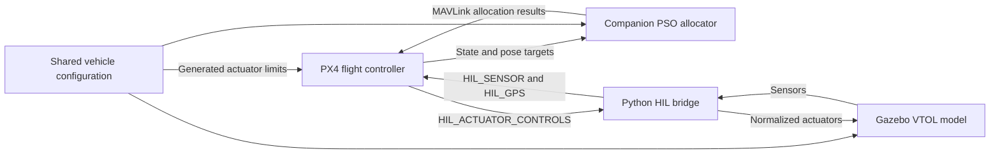

# VTOL26

VTOL26 develops particle swarm optimization (PSO) actuator allocation for a VTOL
aircraft. It combines companion software, custom PX4 firmware and Gazebo
simulation around a shared vehicle model.

## Architecture

PX4 supplies aircraft position, velocity, attitude and pose targets to the
companion over MAVLink. The allocator uses the vehicle model to evaluate
candidate actuator settings and returns nine values: three motor commands, two
rotor tilts, two ruddervator angles and two aileron angles.



PX4 validates received allocations and publishes them internally as
`pso_allocation`. Desktop SIL and Pixhawk HIL use profile 22001 and send fresh
allocations from `pso_control` to the Gazebo plant over the Python HIL bridge.
The companion also writes results as JSON for inspection. On the aircraft, PX4
runs on a Pixhawk 6C and the companion runs on a Raspberry Pi 4B. Desktop tests
run PX4 and the allocator on the development computer.

Vehicle geometry, physics and actuator limits come from
[config/vehicle.json][vehicle-config]. The allocator and custom Gazebo plant
share the vehicle force model; optimizer tuning is kept separately from vehicle
settings. See the [vehicle configuration reference][vehicle-reference] for
actuator order, units and calibration requirements.

Install the shared vehicle contract with `./config/install.sh` before building
or running components (dependencies are in
[config/README.md][vehicle-reference]). The active vehicle is
`~/.local/share/vtol26/config/vehicle.json`; the schema and single validator are
installed in `~/.local/share/vtol26/config/`. Consumers use these fixed user
paths.

Controller builds require the installed vehicle configuration. The build
validates it, saves a snapshot and generates the actuator limits, disarmed
values, HIL channel mapping and thrust coefficients used by PX4's PSO
controller.

The [closed-loop test][gazebo-test] runs the allocator and PX4 against the
custom VTOL plant in `simulation/`, checking target tracking and input-loss
behavior.

## Project organization

| Component                         | Responsibility                                                                 |
| --------------------------------- | ------------------------------------------------------------------------------ |
| [controller/][controller]         | Custom PX4 firmware, desktop PX4 builds and allocation reception.              |
| [companion/][companion]           | Companion software overview and development-computer connection setup.         |
| [companion/allocator/][allocator] | PSO solver, MAVLink transport, runtime configuration and service installation. |
| [companion/image/][image]         | Bootable companion Linux image with the allocator and system configuration.    |
| [simulation/][simulation]         | Gazebo vehicle models, plant plugins and simulation tools.                     |
| [config/][vehicle-reference]      | Shared vehicle physics, geometry and actuator limits.                          |
| [docs/][docs]                     | Mathematical model, flashing and test guides, and supporting references.       |

PX4 is maintained in a separate repository so its versioning and upstream
updates can be managed independently. Clone through VTOL26 to get the complete
workspace.

## Workspace setup

Ubuntu is recommended: the scripts use Bash, and development and testing have
been done on Ubuntu.

```sh
git clone --recurse-submodules https://github.com/sebascert/vtol26.git
cd vtol26
```

Run project commands from this workspace root. Each component README contains
its dependencies and build instructions:

- [PX4][controller]: desktop simulation and Pixhawk firmware builds.
- [Allocator][allocator]: the companion application and service.
- [Companion image][image]: the complete Raspberry Pi system.
- [Simulation][simulation]: the Gazebo environment.

To install on hardware, follow the [Pixhawk flashing guide][flash-pixhawk] and
[companion flashing guide][flash-companion]. The [companion README][companion]
covers Ethernet and SSH access.

## Testing

The allocator, controller and image READMEs describe their automated tests. For
a headless desktop SIL run, build the components and run both loss scenarios:

```sh
./controller/build.sh sitl
./simulation/build.sh
./companion/allocator/build.sh
controller/build/venv/bin/python3 controller/vtol_tests/gazebo_closed_loop.py
```

Two pseudo-terminal pairs stand in for USB and the companion UART. Results are
written to `controller/build/gazebo-closed-loop/`.

The [HIL simulation guide](docs/guides/hil_simulation.md) configures the
external HIL profile, USB bridge and separate companion link.

The [mathematical model][model] and [vehicle configuration][vehicle-reference]
define the physical assumptions behind allocation and simulation. Supplied
vehicle values are placeholders; physical outputs require calibrated motor and
servo conversion. Model convergence alone does not establish flight stability.

[controller]: controller/README_VTOL.md
[companion]: companion/README.md
[allocator]: companion/allocator/README.md
[image]: companion/image/README.md
[simulation]: simulation/README.md
[vehicle-config]: config/vehicle.json
[vehicle-reference]: config/README.md
[docs]: docs/
[model]: docs/model/vtol_model.tex
[flash-pixhawk]: docs/guides/flash_pixhawk.md
[flash-companion]: docs/guides/flash_raspberry_pi.md
[gazebo-test]: controller/vtol_tests/gazebo_closed_loop.py
