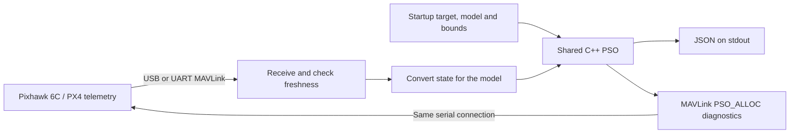

# Stallion VTOL: project progress, study and presentation guide

Status snapshot: **4 November 2026**. Read this alongside the
[system overview](../architecture/system_overview.md) and the existing
[PSO/PX4 integration presentation](../../presentations/pso_px4_integration_gap.md).

Source links were updated for the component reorganization: the PSO runtime is
now owned by `companion/allocator/src/pso/`, the Pi image by `companion/image/`,
Gazebo by `simulation/`, and future PX4 patches by `controller/`. The dated test
and build observations below remain historical evidence, not a new validation.

The main advance is a working path from live PX4 telemetry to actual particle
swarm optimization and bounded nine-value actuator candidates. That path has
been exercised over USB on the laptop and is also documented as tested on the
Raspberry Pi. Direct Ethernet SSH access to the Pi has been demonstrated after
a reboot. The dedicated Yocto image is defined, but a completed image and its
first boot have not been demonstrated.

This guide explains the current implementation, the evidence behind those
claims, and how to present the remaining integration work accurately.

## 1. The project in one minute

Stallion is a tricopter-to-fixed-wing VTOL research platform. The intended
architecture combines a Pixhawk 6C running PX4 with a Raspberry Pi 4B running
vehicle-specific optimization. The repository also contains the standalone
PSO experiment, MATLAB/Simulink modeling, CAD, and historical firmware.

The current companion receives the vehicle's measured state, predicts the
effect of candidate actuator settings through a mathematical model, and uses
PSO to select a low-cost candidate. It prints the result as JSON and sends it
back over MAVLink as diagnostic data.

A useful opening statement for a presentation is:

> We have connected live PX4 telemetry to a real, bounded PSO implementation,
> demonstrated numerical allocation on the bench, and established persistent
> Ethernet access to the Raspberry Pi. Applying the results through PX4's
> actuator pipeline and validating the aircraft model are the next milestones.

Sources: [project README](../../../README.md),
[companion README](../../../companion/allocator/README.md).

## 2. Understand the three different kinds of information

| Information | Question it answers | Current implementation |
| --- | --- | --- |
| Vehicle state | Where is the vehicle, how is it oriented, and how is it moving? | Received from PX4 through MAVLink. |
| Pose target | Where should the model go, and with what orientation? | Read from the companion's startup JSON configuration. |
| Controller demand | What body force and torque do PX4's controllers request? | No receiving interface in the current companion. |

This distinction explains the project's integration boundary. The current
solver optimizes actuators against a pose target. A conventional control
allocator instead receives desired forces/torques from a controller and finds
actuators that produce them. Both can use PSO, but their inputs and objectives
differ.

Today there is also no implementation that converts the diagnostic result into
accepted PX4 motor or servo outputs. A successful numerical allocation does
not establish that PX4 applied it.

Sources: [state adapter](../../../companion/allocator/src/pso_interface.cpp),
[optimizer API](../../../companion/allocator/src/pso/pso_runtime.hpp),
[actual sender](../../../companion/allocator/src/mavlink_sender.cpp).

## 3. Architecture: what runs where

The implemented computation path is:



The companion can run on the Ubuntu laptop or on the Pi. It does not require
Raspberry Pi-specific hardware to exercise its solver and serial protocol.
The Pi's GPIO UART setup is a separate hardware integration step.

The management connection is separate from the telemetry connection:

```text
Ubuntu laptop Ethernet                     Raspberry Pi Ethernet
192.168.76.1/24  <------ direct cable ------> 192.168.76.2/24
                         SSH

Raspberry Pi USB  <------ USB cable -------> Pixhawk 6C
                      MAVLink bench test
```

The planned GPIO alternative uses Pi TX/RX/GND and Pixhawk TELEM2. Its wiring,
voltage levels and power arrangements are documented in the
[physical connection guide](raspberry_pi_pixhawk_6c_wiring.md). USB test success
does not validate that GPIO wiring.

## 4. What changed from the earlier prototypes

| Area | Earlier material | Current advance |
| --- | --- | --- |
| Companion optimization | The recovered legacy MAVLink adapter returned fixed values. | Live state is passed to the shared PSO solver. |
| Result transport | The legacy allocation sender printed values. | The active sender encodes and writes MAVLink diagnostic allocations. |
| Reuse | The standalone swarm and companion were separate paths. | CMake compiles the runtime in `companion/allocator/src/pso/` using `PSO_RUNTIME_ONLY`; the earlier standalone experiment is archived. |
| Input handling | Merely receiving some telemetry was insufficient evidence. | Four required messages, source selection, numeric checks and freshness gates are explicit. |
| Output handling | A function name could suggest physical control without implementing it. | The output contract identifies nine model values and their diagnostic meaning. |
| Dependencies | Unchanged MAVLink headers had been copied into the project. | The active build downloads a pinned, SHA-256-checked upstream archive. |
| Deployment | Manual setup and historical instructions were mixed. | A Pi OS installer, a USB bench launcher and a Yocto layer now describe distinct deployment paths. |
| Maintenance | Historical implementations could be mistaken for current code. | Legacy material and its audit are separated from the active runtime. |

The [backup audit](backup_pso_px4_audit.md) also records a real historical
six-variable STM32/Arduino PSO. That is a useful algorithm reference with a
different controller and actuator interface. The audit did not recover a
complete Raspberry Pi/PX4 actuator-control integration within the material
examined.

Sources: [active build](../../../companion/allocator/CMakeLists.txt),
[legacy fixed adapter](../../../legacy/mavlink_uart/src/pso_interface.cpp),
[legacy sender](../../../legacy/mavlink_uart/src/mavlink_sender.cpp),
[backup findings](backup_pso_px4_audit.md).

## 5. Follow one allocation through the code

Read these steps in order while keeping the linked files open.

1. **Load configuration.** Startup reads the model, target, nine actuator bounds
   and initial candidate. Invalid configuration causes startup to fail.
2. **Receive telemetry.** The first PX4 heartbeat selects the source system and
   component. Messages from other sources cannot replace the selected state.
3. **Check readiness.** All four required inputs must be recent. Non-finite
   values invalidate their corresponding input.
4. **Adapt coordinates.** The adapter negates NED Z and vertical velocity for
   the inherited positive-up model. Attitude and body rates pass through;
   complete frame consistency remains to be validated.
5. **Optimize.** The shared solver searches around the previous result within
   physical configuration bounds and the local sampling window.
6. **Recheck freshness.** Before publishing, the program checks the inputs used
   for the solve and the latest received state. A solve can be withheld if its
   inputs expired during computation.
7. **Publish.** The sender writes a diagnostic MAVLink result, then the program
   prints the JSON record.
8. **Repeat or suspend.** Stale telemetry suspends output and resets the search
   center. Serial and solver failures terminate the program with an error.

| Required message | Information used | Rate observed in the laptop QGroundControl session |
| --- | --- | ---: |
| `HEARTBEAT` | PX4 identity and liveness | 1 Hz |
| `ATTITUDE` | Roll, pitch, yaw and body rates | 50 Hz |
| `LOCAL_POSITION_NED` | Local position and velocity | About 30 Hz |
| `VFR_HUD` | Airspeed | 20 Hz |

These observed rates were adequate for the default three-second freshness
window. They are bench observations, not a required or validated flight-control
rate specification. GPS altitude is not substituted for local position.

Sources: [main loop](../../../companion/allocator/src/main.cpp),
[receiver](../../../companion/allocator/src/mavlink_receiver.cpp),
[freshness state](../../../companion/allocator/src/drone_state.hpp),
[adapter](../../../companion/allocator/src/pso_interface.cpp).

## 6. Understand PSO without confusing it with vehicle motion

A particle is one candidate vector of actuator values. It is not a separate
vehicle. Each particle keeps its best candidate; the swarm also keeps the
best candidate found by any particle. In the implementation, particle movement
combines inertia, attraction to its personal best and attraction to the swarm
best:

```text
velocity = w * previous_velocity
         + c1 * random1 * (personal_best - candidate)
         + c2 * random2 * (swarm_best - candidate)

candidate = candidate + velocity
candidate = clamp(candidate, allowed_sampling_lower, allowed_sampling_upper)
```

For each candidate, the model calculates forces and moments, predicts position
and orientation, and evaluates a cost. With an active pose target, that cost
contains weighted squared position error, squared quaternion orientation error,
and a dynamics term involving predicted displacement and moments. The weights
in the configuration must be interpreted with the model's units. The current
objective is not a measured electrical-power model.

The previous allocation is retained as a candidate. With identical measured
inputs, another solve cannot worsen its fitness. Live input changes mean that
fitness can still rise or fall between consecutive output lines.

The JSON configuration requests more particles and iterations than the runtime
allows by default. The CLI limits cap execution at 16 particles, five iterations
and one external cycle. Therefore the default evaluation count is:

```text
1 starting candidate + 16 initial particles + 16 * 5 updates = 97 evaluations
```

The sampling radius is also separate from the global actuator limits. With
`k_am = 50`, rotor candidates can move within 50 model units of the center;
angle sampling amplitudes use a factor of 0.02, giving one radian before global
bounds are applied. This helps explain repeated rotor changes of 50 and angle
values landing on configured limits.

Keep these three time scales separate:

| Setting | Default | Meaning |
| --- | ---: | --- |
| Main-loop sleep | 20 ms | Delay between receiver-loop iterations, excluding other work. |
| PSO period | 1000 ms | Scheduling interval; execution time adds to the actual output spacing. |
| Prediction time step | 0.1 s | Model horizon for evaluating a candidate. |

Neither the 97 evaluations nor the one-second scheduling interval establishes
a flight-suitable latency bound. Pi execution-time measurements are still needed.

Sources: [solver and model](../../../companion/allocator/src/pso/pso_environment.cpp),
[sampling state](../../../companion/allocator/src/pso/pso_state.hpp),
[runtime defaults](../../../companion/allocator/src/application_config.hpp),
[companion configuration](../../../companion/allocator/src/pso/config.json).

## 7. Read and explain the actual output

This record was supplied from the successful laptop USB session:

```json
{"actuators":[1044.25489156,1100,1000,0,1.29114351351,-0.209408625255,-0.395993340376,0.5,0.452653686208],"fitness":1208.50921303,"position_error_m":10.8830357747,"position_converged":false,"objective_evaluations":97}
```

| Array indices | Meaning | Current configured range |
| --- | --- | --- |
| 0–2 | Left, right and rear rotor commands | 0 to 2000, uncalibrated model units |
| 3–4 | Left and right rotor tilt | 0 to approximately 1.571 rad |
| 5–6 | Left and right ruddervator deflection | −0.5 to 0.5 rad |
| 7–8 | Left and right aileron deflection | −0.5 to 0.5 rad |

`fitness` is the model's cost, with lower values preferred for the same input
state. `position_error_m` is the predicted distance to the configured target
after the 0.1-second model step. `position_converged` only checks whether that
distance is at most 0.5 m; it does not check all attitude or control objectives.
The configured target is local model position `[0, 0, 10]` and orientation
`[0, 0.1, 0]` radians, rather than GPS altitude or a live mission demand.

The stationary bench hardware does not move in response to these candidates.
An error around 10.9 m and `false` therefore do not indicate a broken serial
connection. Values at an angle bound indicate a bounded search result; they do
not establish that the chosen deflection is physically useful.

The result is also sent as MAVLink `DEBUG_FLOAT_ARRAY`, name `PSO_ALLOC`, array
ID 0, system 245/component 191. Slots 0–8 carry actuator candidates; slots 9–12
carry fitness, position error, convergence and evaluation count. A successful
serial write does not provide an actuator-application acknowledgement from PX4.

In a presentation, describe these as **finite, bounded model candidates**.
Physical validity, global optimality and closed-loop stability require further
evidence.

Sources: [output contract](../../../companion/allocator/README.md#allocation-result),
[MAVLink encoding](../../../companion/allocator/src/mavlink_sender.cpp),
[configured target and bounds](../../../companion/allocator/src/pso/config.json).

## 8. Evidence: what has actually been demonstrated

| Advance | Evidence available | What it establishes |
| --- | --- | --- |
| Laptop USB integration | QGroundControl screenshots showed PX4 identity and the four streams; the user supplied live allocation JSON. | Real telemetry reaches the running solver and produces results. |
| Pi USB execution | The runtime README records a Pi 4B / Ubuntu 22.04.5 / Pixhawk 6C test with 14 finite, bounded allocations in 15 seconds and two existing tests passing. | The ARM/Linux companion runs with real USB telemetry. This guide did not repeat that hardware test. |
| Ethernet hardware and addressing | Pi `eth0` reported 1 Gbps/full duplex. Laptop routing selected `enp46s0`, source `192.168.76.1`; four pings returned with 0% loss and 0.276 ms average RTT. | The direct cable and chosen IPv4 subnet work. |
| SSH persistence | The user logged in as `seb` on the current Ubuntu Pi, then reported successful reconnection after reboot. | Current Ubuntu Ethernet and SSH setup survives a Pi reboot. |
| Automated software coverage | Existing test sources exercise solver bounds, invalid inputs, source filtering, result decoding and timeout suppression; retained laptop logs show installer/allocation tests passing. | Tested software behaviors, not aircraft control performance. |
| Image provisioning | Four image tests passed earlier in this session; metadata parsing and a 5,204-task dry run passed; companion fetch/unpack tasks succeeded. | Build-definition and provisioning checks; no completed operating-system image. |

The current CMake test suite also registers a launcher test, alongside installer
and allocation tests. Its fixture checks executable/config resolution from a
different directory and argument forwarding. Avoid treating older two-test
logs as evidence that every subsequently added test has run.

Tests and records: [allocation test](../../../companion/allocator/tests/allocation_test.cpp),
[installer smoke test](../../../companion/allocator/tests/install_test.sh),
[launcher test](../../../companion/allocator/tests/run_companion_test.sh),
[image tests](../../../companion/image/tests/test_image.py),
[Pi bench record](../../../companion/allocator/README.md#usb-bench-test-on-the-pi).

For future presentations, retain raw timestamped allocation logs, firmware
version, model configuration and exact test commands together. Screenshots
and selected JSON records support a demonstration; complete logs allow another
person to examine timing, losses and repeatability.

## 9. Deployment progress and the image's actual status

There are three useful deployment paths:

| Path | Purpose | Default connection |
| --- | --- | --- |
| Build and foreground launcher on Ubuntu/Pi | Interactive bench testing, including the demonstrated Pi USB setup. | USB at 115200 baud; port can be overridden. |
| Raspberry Pi OS installer | Install dependencies, build/test, preserve existing calibration and enable a user service. | GPIO UART `/dev/serial0` at 57600 baud. |
| Dedicated Yocto image | Preinstall the application, Ethernet, SSH and service configuration. | Same GPIO UART default; Ethernet manages the Pi. |

The [installer](../../../companion/allocator/deploy/install.sh) and
[USB launcher](../../../companion/allocator/deploy/run-companion.sh) serve
different purposes. The launcher does not enable a boot service. The image
uses its own recipe and install paths rather than running the apt installer.

The image definition targets `raspberrypi4-64` with Poky/meta-raspberrypi
Scarthgap. Its application comes from a snapshot of this working tree. The
example `yocto_pr1` repository is a structural reference, not the application
source or a layer dependency. The MAVLink headers are separately pinned and
checksum-verified.

The network settings match the configuration provided for the successful
Ubuntu Ethernet test. The image additionally enables networkd and includes
OpenSSH. Its intended login is:

| Setting | Dedicated image | Current tested Ubuntu Pi |
| --- | --- | --- |
| Pi address | `192.168.76.2/24` | `192.168.76.2/24` |
| Laptop address | `192.168.76.1/24` | `192.168.76.1/24` |
| User | `vtol` | `seb` |
| SSH authentication | Provisioned public key; password login disabled | Password login demonstrated |
| Status | Defined; image boot unverified | Tested, including after reboot |

For the future flashed image, run from the repository root:

```sh
ssh -o IdentitiesOnly=yes \
  -i companion/image/build/ssh/id_ed25519 vtol@192.168.76.2
```

There is no configured image password. Keep the matching private key on the
laptop; the image contains its public key. The direct Ethernet configuration
does not share the laptop's Internet connection with the Pi.

**Build status at this guide's inspection:** a full build was started on
3 November. The retained log reached task 2,432 of 5,204. On 4 November the
`vtol-image-build.service` was inactive, and no completed image was found in
the expected deployment location. The reason the build stopped has not been
established here. A previous estimate of build duration is not completion
evidence. Before presenting a finished image, resume/complete the build and
verify its artifacts and first boot.

Useful local checks, from the repository root:

```sh
systemctl --user status vtol-image-build.service
tail -n 30 companion/image/build/previous-image-build.log
ls companion/image/build/yocto/tmp/deploy/images/raspberrypi4-64/
```

Completion evidence must include a successful BitBake summary, the compressed
WIC image and image manifest, followed by Pi boot and SSH tests on that image.
A task counter is not a percentage of time remaining.
The `previous-image-build.log` file is retained evidence from the earlier build;
fresh builds under the reorganized image directory need a new log.

Sources: [full image guide](../../../companion/image/README.md),
[network file](../../../companion/image/meta-vtol/recipes-core/vtol-config/files/10-vtol-ethernet.network),
[user/key installation](../../../companion/image/meta-vtol/recipes-core/vtol-config/vtol-config.bb),
[SSH policy](../../../companion/image/meta-vtol/recipes-connectivity/openssh/files/sshd_config),
[network service enablement](../../../companion/image/meta-vtol/recipes-core/systemd/systemd_%.bbappend).

## 10. The engineering gaps to explain clearly

### Model feasibility and calibration

The current model uses linear rotor thrust `T = 0.00024 * omega`, with each of
three rotor commands bounded by 2000. Its maximum total rotor thrust is:

```text
T_max = 3 * 2000 * 0.00024 = 1.44 N
Weight = 4 kg * 9.81 m/s² = 39.24 N
```

At zero airspeed the modeled aerodynamic terms vanish, so these defaults cannot
support hover. They need measured units, propulsion data and consistent bounds;
increasing the number of particles cannot repair physical infeasibility.
Geometry, aerodynamic contributions and body/world frame conventions also
require validation.

### PX4 demand and output interfaces

For the proposed PX4-controller-plus-PSO-allocator architecture, the missing
loop is:

```text
Target -> PX4 controllers -> demanded force/torque -> Pi PSO
                                                        |
Vehicle motion <- actuators <- validated PX4 application <- result
```

It requires an explicit demand interface, an objective that tracks those
demands, output units/channel mapping, ownership of the actuators, acceptance
and expiry rules, and defined behavior when commands stop. A diagnostic message
does not implement these requirements.

### Timing, UART and failure handling

USB execution has been demonstrated. Pi GPIO/TELEM2, maximum solve latency,
command deadlines and hardware loss/disarm behavior remain unverified. The
existing three-second telemetry gate protects result freshness at the
application level; it does not implement a complete actuator failsafe.

### Simulation and HIL

The [Gazebo HIL plan](gazebo_pso_hitl_plan.md) describes proposed work. A complete
experiment needs simulated sensors into PX4, PSO results accepted through PX4,
and applied actuator outputs driving the simulated plant. Live allocation JSON
alone does not establish that loop. SITL runs a software flight controller;
HIL includes the physical flight controller. The existing Gazebo material must
be evaluated against the chosen plant, bridge and firmware interfaces.

## 11. A ten-minute presentation plan

| Time | Topic | Evidence or visual | Main point to say |
| --- | --- | --- | --- |
| 0:00–1:00 | Problem and roles | Architecture diagram | PX4 provides flight-controller functions; the Pi hosts vehicle-specific optimization. |
| 1:00–2:00 | Progress from the prototypes | Earlier/current comparison | Real telemetry now drives actual PSO and produces bounded results. |
| 2:00–3:30 | Algorithm | Particle update and nine-value table | Each particle represents an actuator candidate evaluated through a model. |
| 3:30–5:00 | Hardware evidence | QGroundControl stream captures and allocation JSON | Live telemetry and numerical execution work on the bench. |
| 5:00–6:00 | Pi access | Ethernet address/routing, ping and SSH evidence | The development connection survives a Pi reboot. |
| 6:00–7:00 | Deployment | Installer/launcher/image comparison | Deployment paths exist; the dedicated image still needs a completed build and first boot. |
| 7:00–8:30 | Limits | Thrust feasibility calculation and missing output interface | Model calibration and PX4 actuator application define the next engineering work. |
| 8:30–10:00 | Next demonstration | Proposed closed loop | Trace one demand to an accepted output and measured or simulated response. |

A suitable closing statement is:

> The bench results establish communication, optimization and maintainable Pi
> access. The next demonstration must connect a defined controller demand to a
> calibrated allocation, an accepted PX4 actuator output and an observable
> vehicle response, including command-loss handling.

For a live demonstration, keep actuator power disconnected, use one reader of
the serial port, and show the actual input streams and JSON. Use the existing
[bench instructions](../../../companion/allocator/README.md#usb-bench-test-on-the-pi)
for the commands. If telemetry is unavailable, identify the automated test as
a synthetic-input test rather than presenting it as a live hardware result.

## 12. Study questions and next acceptance milestones

Practice answering these questions without reading the implementation:

| Question | Essential answer |
| --- | --- |
| Why must all four messages arrive? | The solver needs state, motion and airspeed; heartbeat selects the source and freshness gates publication. |
| What does a particle represent? | One nine-actuator candidate, with an associated model cost. |
| Why is the evaluation count 97? | One starting evaluation, 16 initial particles and five updates of 16 particles. |
| Why can convergence remain false? | It tests predicted positional error against a threshold; the bench is not moving toward the configured target, and the model has feasibility limits. |
| Are the rotor values PWM? | No calibrated electrical or RPM conversion is implemented. |
| Does `PSO_ALLOC` move a servo? | The current message reports diagnostic candidates; no PX4 actuator application is implemented. |
| Why are repeated angle limits important? | They show bound-constrained candidates, not proof of useful or stable actuation. |
| Did rebooted SSH prove the Yocto image works? | It proved the address plan and current Ubuntu setup; the image and its key-only account need their own boot test. |
| What would prove closed-loop progress? | A trace from controller demand through accepted/applied outputs to the corresponding vehicle response, with timing and failure evidence. |

Use the following milestones to turn the remaining work into reviewable results:

1. **Image completion:** successful build artifacts, flashed-card boot, expected
   Ethernet address, key login as `vtol`, and companion service startup.
2. **Model agreement:** measured actuator conversions and an agreed force/moment
   model, including feasible trim/hover cases and consistent frames.
3. **Control contract:** select pose control or PX4 demand-based allocation;
   define inputs, output ownership, units, timestamps and expiry behavior.
4. **PX4 application:** log proposed, accepted and actually applied values
   separately; verify mapping, bounds, arming gates and loss behavior.
5. **Closed-loop simulation/HIL:** demonstrate the complete response through
   the selected plant and bridge with predefined tracking and latency criteria.

For deeper reading, start with the [main loop](../../../companion/allocator/src/main.cpp),
then the [state adapter](../../../companion/allocator/src/pso_interface.cpp),
[runtime API](../../../companion/allocator/src/pso/pso_runtime.hpp),
[solver](../../../companion/allocator/src/pso/pso_environment.cpp),
[configuration](../../../companion/allocator/src/pso/config.json) and
[sender](../../../companion/allocator/src/mavlink_sender.cpp). Finish with the
[HIL acceptance plan](gazebo_pso_hitl_plan.md#implementation-milestones-and-pass-criteria)
and [historical audit](backup_pso_px4_audit.md) to understand which earlier
components can inform the remaining design.

This document records inspected source and existing test/session evidence.
It does not add new flight, GPIO, HIL or image-boot validation.
