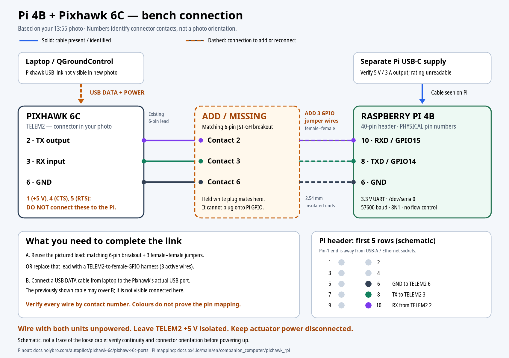

# Connect the Raspberry Pi companion to a Pixhawk 6C

Reviewed: 2026-10-30. Target: **Raspberry Pi 4 Model B with Raspberry Pi OS**, a
**Holybro Pixhawk 6C running PX4**, and this repository's
[`mavlink_uart` companion](../../companion/mavlink_uart/README.md).
Record your actual board revision and PX4 version before following the guide;
parameter availability and menus can differ between firmware releases.

The connection is a three-wire, **3.3 V TTL UART** link from the Pixhawk's
**TELEM2** connector to the Pi's 40-pin GPIO header. The repository currently
uses `/dev/serial0`, **57600 baud, 8N1, no hardware flow control**. These settings
come from the [service](../../companion/mavlink_uart/deploy/mavlink-uart@.service)
and [serial configuration](../../companion/mavlink_uart/src/serial_port.hpp).

This establishes telemetry reception and allocation reporting. The companion
returns JSON and MAVLink `DEBUG_FLOAT_ARRAY`; it does not drive physical motor
or servo outputs. Keep the aircraft disarmed, remove propellers and disconnect
actuator power throughout this bench procedure.

## Connection diagram for the 13:55 photo



[Download the editable/vector diagram](../images/pi4b-pixhawk6c-bench-wiring.svg).
Solid signal segments represent the lead already plugged into TELEM2; dashed
segments and the orange box show the adaptation still needed. Verify continuity;
the photo does not establish which contact each conductor reaches.

The loose white connector in your hand is the other end of the TELEM2 lead.
It cannot connect directly to the Pi's male GPIO header. To reuse it, add a
matching **6-pin JST-GH receptacle breakout with a 2.54 mm male header**, plus
**three female-to-female GPIO jumper wires**. Alternatively, replace the shown
lead with a correctly wired TELEM2-to-female-GPIO harness. Only contacts
**2 (TX), 3 (RX), and 6 (GND)** connect to the Pi; leave **1 (+5 V), 4 and 5**
isolated from its header. The mapping is shown in section 2 and follows the
[Holybro TELEM2 pinout](https://docs.holybro.com/autopilot/pixhawk-6c/pixhawk-6c-ports#telem-2-port).

The braided Steren cable in the new photo is plugged into the **Pi's USB-C
power socket**. It is not a laptop-to-Pixhawk link. No such link is visible
in this photo; reconnect the earlier USB data cable if available. The Pi's
micro-HDMI cable is for a display and does not communicate with the Pixhawk.
The adapter's supply rating remains unverified.

## Current hardware: photo review, 2026-10-30

The owner confirms a **Raspberry Pi 4B** and **Pixhawk 6C**. The first photo
(12:35) shows the boards, a white Steren supply, a USB-to-UART-style adapter and
a bag marked `#18079`. The second photo (13:55) clearly shows a lead in TELEM2,
its loose six-contact plug, and the Pi's USB-C power connection. No laptop-to-
Pixhawk USB link is visible in the second photo. Photos do not establish
continuity, supply ratings or whether a USB cable carries data.

| Item needed for this bench connection | Status from the photo / next action |
| --- | --- |
| Raspberry Pi 4B and Pixhawk 6C | Present; models confirmed by the owner. |
| Pi USB-C power supply and cable | Present, but the Steren output label is unreadable. Verify its 5 V output/current rating before use; see section 3. |
| Laptop-to-Pixhawk USB data cable | Not visible connected in the 13:55 photo. Use the earlier data cable if available and confirm QGroundControl connects. |
| TELEM2-to-Pi UART harness | Six-contact TELEM2 lead is present in the second photo. Its free plug needs the breakout and three GPIO jumpers shown above, or replace the lead with a TELEM2-to-GPIO harness. |
| microSD with Raspberry Pi OS | Not verifiable from this view; check that a card is installed and the Pi boots. |
| Multimeter | Not visible; borrow/use one to verify the harness mapping before power-up. |
| Cooling for sustained PSO computation | No heatsink/fan is apparent; [cooling can reduce thermal throttling](https://www.raspberrypi.com/documentation/computers/raspberry-pi.html#add-heatsinks), but is not required merely to connect UART. |

The remaining cable work is **adapting the free end of the existing TELEM2
lead**. The first photo's cable bag may contain useful parts; its contents
still need inspection. The required wiring is
TELEM2 **2 → Pi 10**, **3 → Pi 8**, **6 → Pi 6**; identify pins rather than
matching colours. The visible USB-to-UART adapter is unnecessary for this
direct GPIO arrangement, and its logic voltage is unverified.

A flight power module, battery and Pi BEC are **not needed for the USB-powered
bench arrangement** below. They belong to the later aircraft power setup.

## 1. Gather the hardware and identify the connectors

You need the Pi, its microSD/Raspberry Pi OS installation, the Pixhawk, a USB
cable for configuring PX4 with QGroundControl, separate suitable power supplies,
and a TELEM2 breakout lead ending in insulated female connectors for the Pi
header. Use the correct six-contact telemetry lead supplied for the 6C; see
[Holybro's 6C cable set](https://holybro.com/products/pixhawk-6c-cable-set).
Do not force a visually similar connector into the socket.

Locate **TELEM2** using the board label and
[Holybro's port diagram and pin-numbering illustration](https://docs.holybro.com/autopilot/pixhawk-6c/pixhawk-6c-ports).
Identify contact numbers from that illustration, then trace each cable wire.
Wire colours alone do not identify signals, and looking into a plug instead of
at a board socket can reverse the apparent order.

Pi **physical pin numbers** below refer to positions on the 40-pin header;
**GPIO14/GPIO15** are GPIO names, not physical positions. Locate pin 1 using
the board markings and the official
[Raspberry Pi GPIO pin table](https://www.raspberrypi.com/documentation/computers/raspberry-pi.html#gpio).
This guide does not cover a Pi 5 or Compute Module carrier's UART routing.

## 2. Connect exactly TX, RX and ground

Shut down the Pi and remove **all** power, including Pixhawk USB, before wiring.

| Pixhawk 6C TELEM2 contact | Signal at the Pixhawk         | Connect to Raspberry Pi 4           |
| ------------------------- | ----------------------------- | ----------------------------------- |
| 1                         | +5 V peripheral supply        | **Leave disconnected and insulate** |
| 2                         | UART5_TX, output, 3.3 V logic | **Physical pin 10**, GPIO15 / RXD   |
| 3                         | UART5_RX, input, 3.3 V logic  | **Physical pin 8**, GPIO14 / TXD    |
| 4                         | UART5_CTS, input              | Leave disconnected                  |
| 5                         | UART5_RTS, output             | Leave disconnected                  |
| 6                         | GND                           | **Physical pin 6**, GND             |

The 6C signals are specified in
[Holybro's TELEM2 pinout](https://docs.holybro.com/autopilot/pixhawk-6c/pixhawk-6c-ports#telem-2-port).
PX4 independently documents the same
[Pi-to-Pixhawk TX/RX/GND mapping](https://docs.px4.io/main/en/companion_computer/pixhawk_rpi#serial-connection).

```text
Pixhawk 6C TELEM2                        Raspberry Pi 4 GPIO header
pin 2  TX  ---------------------------> physical pin 10  RX (GPIO15)
pin 3  RX  <--------------------------- physical pin 8   TX (GPIO14)
pin 6  GND ---------------------------- physical pin 6   GND
pins 1, 4, 5: disconnected               power supplied separately
```

Check continuity with power removed: each of those three paths must match the
table, with no shorts between adjacent contacts. Secure the lead against
movement and insulate every unused conductor. Keep the cable short and route it
away from ESC/motor power wiring.

Use direct 3.3 V logic connections; an RS-232 cable is electrically different.
Do not connect TELEM2 +5 V to a Pi GPIO signal or power pin. Pi GPIO inputs are
**not 5 V tolerant**, as stated in the
[Raspberry Pi voltage guidance](https://www.raspberrypi.com/documentation/computers/raspberry-pi.html#gpio).

## 3. Power the two computers separately

**Yes: the Pi may use its own USB-C supply while the Pixhawk is powered and
connected to the laptop over USB.** PX4 explicitly describes this bench
arrangement, with the flight controller on the ground-station computer's USB
and the companion on a desktop supply. See
[PX4's companion power guidance](https://docs.px4.io/main/en/companion_computer/pixhawk_rpi#power-supply).
The Pixhawk's USB connection and TELEM2 UART can be used together: the laptop
runs QGroundControl, while the Pi uses TELEM2.

```text
Steren supply, IF its rating is suitable
  └── USB-C power ──> Raspberry Pi 4B
                         │
                         └── TX / RX / GND only ──> Pixhawk 6C TELEM2
Laptop USB ── power + data ────────────────────────> Pixhawk USB
```

**The pictured Steren adapter is not yet verified.** Its OUTPUT label and model
number are not readable. Check for a regulated **5 V output capable of at
least 3 A** with a suitable USB-C cable; the manufacturer's recommended Pi 4
supply is **5.1 V, 3 A**. A claim such as “20 W” or a high-current 9 V mode
alone does not establish enough current at 5 V. Do not force 9 V or 12 V onto
the Pi. Raspberry Pi documents its
[power requirements and recommended supplies](https://www.raspberrypi.com/documentation/computers/raspberry-pi.html#power-supply).
An inadequately rated supply can appear to boot the Pi but fail under load.

For context, Holybro specifies a **4.75–5.25 V USB power input** for the 6C;
see its [electrical specifications](https://docs.holybro.com/autopilot/pixhawk-6c/technical-specification).
Use a functioning laptop USB data port/cable and leave actuator power
disconnected. This USB setup powers the controller, not a motor/servo system.

Connect only the three UART conductors in section 2. **TELEM2 pin 1 (+5 V)
stays disconnected**, as do pins 4 and 5. Keep the ground wire even though
the units have separate supplies. Do not join their positive supply rails or
try to power the Pi through a telemetry connector.

With both units initially unpowered, finish and check the signal harness;
then power the Pi from the verified supply and the Pixhawk from the laptop.
Confirm that QGroundControl connects, the Pi boots, and the companion receives
the required telemetry.

For an aircraft installation, use a suitably rated Pi regulator/BEC and the
approved Pixhawk power-module input; retain the UART ground connection. The
photo and this bench procedure do not validate aircraft power distribution.

## 4. Enable the Pi UART and release the serial console

On the Pi, using SSH or a local terminal, run:

```sh
sudo raspi-config
```

Under **Interface Options → Serial Port**, answer **No** to the serial login
shell and **Yes** to enabling serial hardware, then reboot. See
[Raspberry Pi's serial-port configuration](https://www.raspberrypi.com/documentation/computers/configuration.html#enable-or-disable-serial-port).

After reboot:

```sh
ls -l /dev/serial0
readlink -f /dev/serial0
```

Use the alias `/dev/serial0` in this project rather than assuming it always maps
to `/dev/ttyAMA0`. If using the Pi 4 mini UART, follow the official UART clock
requirements. An alternative is the documented `disable-bt` overlay and
`hciuart` service change to assign the PL011 UART to the header; this disables
Bluetooth and requires a reboot. Details are in
[Raspberry Pi's UART configuration](https://www.raspberrypi.com/documentation/computers/configuration.html#configure-uarts).

## 5. Configure PX4 for this MAVLink connection

Connect QGroundControl to the Pixhawk over USB. Save a parameter backup before
changing the telemetry configuration. Keep USB available for the PX4 console.

Use the parameter editor to assign **one MAVLink instance** to TELEM2. This
example uses instance 1; if it already serves another connection, select a free
instance and substitute its index in `MAV_1_*`. Avoid assigning a second driver
or MAVLink instance to the same port. PX4 describes this allocation in
[MAVLink peripherals configuration](https://docs.px4.io/main/en/peripherals/mavlink_peripherals).

| Parameter         | Value for this bench setup                                   |
| ----------------- | ------------------------------------------------------------ |
| `MAV_1_CONFIG`    | **TELEM 2 (102)**                                            |
| `SER_TEL2_BAUD`   | **57600**                                                    |
| `MAV_1_MODE`      | **Custom (1)**; explicitly enable the required streams below |
| `MAV_1_FLOW_CTRL` | **Force off (0)**; CTS/RTS are not connected                 |
| `MAV_1_RATE`      | **0**, automatic rate budget                                 |
| `MAV_PROTO_VER`   | **Version 2 (2)**                                            |

The settings and enumerations are documented in PX4's
[parameter reference](https://docs.px4.io/main/en/advanced_config/parameter_reference#mavlink).
Custom mode is a project choice for a small, explicit bench stream set at
57600 baud. Reboot the Pixhawk after applying serial configuration.

Keep MAVLink enabled on TELEM2. Do **not** apply the ROS 2/uXRCE-DDS conversion
steps from the PX4 Raspberry Pi tutorial: this application parses MAVLink,
not DDS. If `UXRCE_DDS_CFG` exists, ensure it does not select TELEM2; disable
that client if it is unused. The
[PX4 Raspberry Pi tutorial](https://docs.px4.io/main/en/companion_computer/pixhawk_rpi#px4-configuration)
uses the same wiring but later changes the protocol and baud rate.

### Enable the four inputs the current companion requires

Open **QGroundControl's MAVLink Console** and run these commands **on PX4**, not
in the Pi's shell. On the Holybro 6C, TELEM2 maps to `/dev/ttyS3`; verify the
[board's serial-port mapping](https://docs.px4.io/main/en/flight_controller/pixhawk6c#serial-port-mapping)
against your hardware/firmware.

```text
mavlink status
mavlink stream -d /dev/ttyS3 -s HEARTBEAT -r 1
mavlink stream -d /dev/ttyS3 -s ATTITUDE -r 5
mavlink stream -d /dev/ttyS3 -s LOCAL_POSITION_NED -r 5
mavlink stream -d /dev/ttyS3 -s VFR_HUD -r 5
mavlink status streams
```

These are suggested bench rates for this project's 3000 ms freshness timeout.
The command syntax and stream diagnostics are documented in the
[PX4 MAVLink module reference](https://docs.px4.io/main/en/modules/modules_communication#mavlink).
Check that the TELEM2 instance is running at 57600 and receiving Pi traffic.
Stream commands configure the running instance; **repeat them after a Pixhawk
reboot** unless you have separately made the stream setup persistent. This
repository's installer does not configure PX4 streams.

The [current receiver](../../companion/mavlink_uart/src/mavlink_receiver.cpp)
needs all four messages from the selected PX4 system/component. GPS alone is
not a substitute for `LOCAL_POSITION_NED`. Without a valid local estimate or an
available airspeed/HUD publication, the application can wait even when the
wiring is correct; verify actual messages rather than just stream requests.
Do not disable estimator/pre-arm checks to make the bench test produce output.

## 6. Install and check the companion

From the repository root **on the Pi**, as your normal user:

```sh
./companion/mavlink_uart/deploy/install.sh
systemctl status "mavlink-uart@$USER.service"
journalctl -u "mavlink-uart@$USER.service" -f
```

The installer builds/tests, grants `dialout` access, preserves an existing PSO
config and enables the service. It starts it if `/dev/serial0` exists. Full
[installation details](../../companion/mavlink_uart/README.md#install-on-raspberry-pi-os)
include the installed config path. The installer does not change Pi UART boot
settings or Pixhawk parameters.

For a foreground check, stop the service first so only one program reads the
UART, then run the installed application:

```sh
sudo systemctl stop "mavlink-uart@$USER.service"
/usr/local/bin/mavlink_uart --port /dev/serial0 --baud 57600 \
  --pso-config /usr/local/share/vtol26/companion/mavlink_uart/src/pso/config.json
```

Log out/in first if your newly added `dialout` membership is not active in this
shell. After testing, press Ctrl+C and restart the service:

```sh
sudo systemctl start "mavlink-uart@$USER.service"
```

A successful receive path produces JSON allocation records, normally about
once per second. Each contains nine actuator candidates, fitness, predicted
position error and `position_converged`. A false convergence flag means the
candidate did not meet the positional tolerance; it does not indicate a UART
fault. No records appear until all required telemetry is fresh.

For the reverse path, check RX activity on the TELEM2 instance using PX4's
`mavlink status`; Pi heartbeat traffic and `PSO_ALLOC` reports share that wire.
QGroundControl on USB may not display `PSO_ALLOC`: receiving a message on
TELEM2 and forwarding it to another MAVLink link are separate settings.

With actuator power disconnected, test the timeout from the PX4 console:

```text
mavlink stream -d /dev/ttyS3 -s ATTITUDE -r 0
```

The Pi should report stale telemetry and suspend allocation after the configured
timeout. Restore the stream with `mavlink stream -d /dev/ttyS3 -s ATTITUDE -r 5`
and check recovery. Keep both computers powered during this test; power down
both before touching the wiring again.

## Troubleshooting

| Symptom                                 | Check                                                                                                                            |
| --------------------------------------- | -------------------------------------------------------------------------------------------------------------------------------- |
| No `/dev/serial0`                       | Pi UART enablement, reboot, correct Pi model and pin routing.                                                                    |
| UART permission error                   | `dialout` membership; log out/in for the shell. Inspect service logs.                                                            |
| No PX4 receive traffic from Pi          | Pi TX → TELEM2 RX, common ground, both baud settings, flow control off.                                                          |
| Pi waits for fresh telemetry            | TELEM2 TX → Pi RX, PX4 MAVLink instance/streams, all four actual messages, valid local estimate.                                 |
| Intermittent or corrupt traffic         | Pin numbering, serial-console conflict, mini UART clock configuration, supply stability, loose/long wiring.                      |
| Allocations stop periodically           | A required stream is missing/slower than the timeout or PX4 is reducing rates to fit link bandwidth; inspect stream diagnostics. |
| Foreground check behaves inconsistently | Stop the service and any other UART readers, including serial-terminal programs.                                                 |
| JSON appears but motors do not respond  | Expected: the current application reports model allocations and has no calibrated physical output mapping.                       |

This document was checked against the linked manufacturer/PX4 references and
the repository's current code. **The physical Pi–Pixhawk connection has not
been tested here.** Record board/PX4 versions, parameter backup, cable mapping,
observed message rates and timeout/recovery results from your bench test before
using the link in an aircraft.
